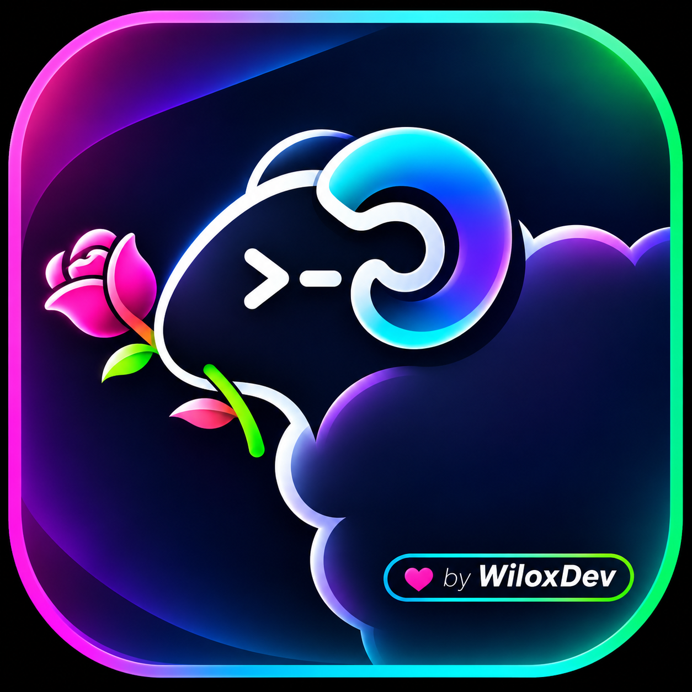

# TelarDev

<p align="center">
  
</p>

<p align="center">
  <strong>Terminal multiplexor ultra rápido para Gentle-Shell: cabina de control con sidebar derecho para explorador, Git Flow visual y telemetría</strong>
</p>

<p align="center">
  <a href="LICENSE"></a>
  <a href="https://github.com/WiloxDev/TelarDev"></a>
  <a href="https://github.com/WiloxDev/TelarDev/stargazers"></a>
</p>

---

## ⚡ La Cabina de Control de Terminal para Gentle-Shell

**TelarDev** es un multiplexor de terminal nativo en Rust con arquitectura cliente-servidor PTY ultra rápida, diseñado como el centro de mando operativo para programadores intensivos en el ecosistema Gentle-Shell.

- 🗂 **Sidebar Lateral Derecho**:
  - **⚡ Status**: Telemetría viva de cuotas, tokens, consumo de contexto y estado de agentes (`working`, `blocked`, `idle`).
  - **📁 Files**: Explorador interactivo con jerarquía en árbol, iconos Seti UI y atajo directo para convertir cualquier carpeta en un espacio de trabajo aislado.
  - **⎇ Git Flow**: Línea de tiempo visual e interactiva de commits, ramas `ahead/behind`, tags, stash, cherry-pick y rebase en vivo.
- 🚀 **Nativo en Rust, Cero Electron**: Desempeño instantáneo, sin sobrecarga de memoria ni lag de renderizado.
- 🔌 **Integración Profunda con Gentle-Shell**: Sincronización continua de estado con agentes a través de sockets IPC locales.
- 🖱 **Teclado y Ratón de Primera Clase**: Atajos tipo tmux/prefix combinados con clics, arrastre, redimensionado y selección fluida.

---

## install

```bash
curl -fsSL https://herdr.dev/install.sh | sh
```

or `brew install herdr` · `mise use -g herdr` · windows: `powershell -ExecutionPolicy Bypass -c "irm https://herdr.dev/install.ps1 | iex"` · [endpoint-protected Windows](https://herdr.dev/docs/windows-beta/) · [binaries](https://github.com/herdrdev/herdr/releases)

then start it where the work lives:

```bash
herdr
```

run your agents, split panes, walk away. `ctrl+b q` detaches, `herdr` reattaches. [quick start →](https://herdr.dev/docs/quick-start/)

## docs

everything lives at [herdr.dev/docs](https://herdr.dev/docs/): [quick start](https://herdr.dev/docs/quick-start/) · [concepts](https://herdr.dev/docs/concepts/) · [supported agents](https://herdr.dev/docs/agents/) · [keyboard](https://herdr.dev/docs/keyboard/) · [configuration](https://herdr.dev/docs/configuration/) · [session state](https://herdr.dev/docs/session-state/) · [connecting machines](https://herdr.dev/docs/connecting-machines/) · [remote](https://herdr.dev/docs/persistence-remote/) · [integrations](https://herdr.dev/docs/integrations/) · [add herdr support to your agent](https://herdr.dev/docs/add-herdr-support/) · [plugins](https://herdr.dev/docs/plugins/) · [socket api](https://herdr.dev/docs/socket-api/)

## thanks

every past sponsor and backer is listed in [SPONSORS.md](./SPONSORS.md) — thank you 🐑

enterprise / partnership: hey@herdr.dev

## agent instructions

if you are an ai agent helping with this repository, read [`AGENTS.md`](./AGENTS.md) before making changes and read [`CONTRIBUTING.md`](./CONTRIBUTING.md) before opening issues or PRs.

## development

```bash
git clone https://github.com/herdrdev/herdr
cd herdr
cargo build --release

just test        # unit tests
just check       # formatting, tests, and maintenance checks
```

## license

Herdr is licensed under the [Apache License 2.0](LICENSE).
